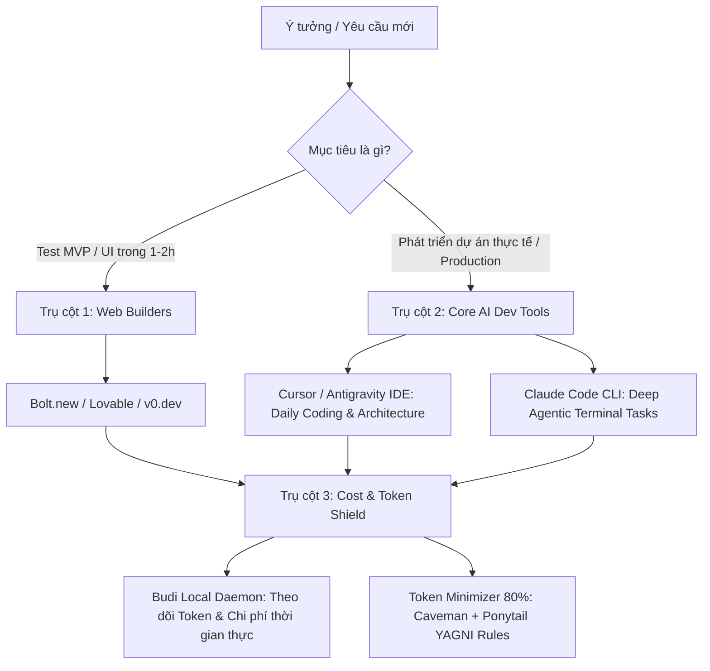

# Curated Vibe Coding & Agentic Engineering Stack

Tối ưu hóa quy trình Vibe Coding bằng cách loại bỏ hơn 90% công cụ dư thừa và tập trung vào 3 trụ cột thiết yếu nhất:

---

## Trụ cột 1: Ra sản phẩm siêu tốc (Web Builders)
Dành cho việc kiểm chứng ý tưởng (Proof of Concept / Prototype / Landing Page) trong vòng vài giờ:
1. **[Lovable.dev](https://lovable.dev/)**: Superhuman full-stack web builder, UI/UX hiện đại, database integration, Supabase & GitHub sync.
2. **[v0.dev by Vercel](https://v0.dev/)**: Chuyên gia Next.js, Tailwind, React component generation chuẩn production.
3. **[Bolt.new](https://bolt.new/)**: Full-stack in-browser WebContainer (Node.js/Vite) chạy trực tiếp trên trình duyệt.

---

## Trụ cột 2: Làm dự án cốt lõi (Core AI Dev & Terminal Agents)
Dành cho codebase phức tạp, repository lớn, enterprise logic và tự động hóa:
1. **[Cursor](https://www.cursor.com/) & [Google Antigravity IDE](file:///C:/Users/Admin/.gemini/config/skills/antigravity_guide/SKILL.md)**:
   - Viết code hàng ngày, multi-file edits, inline lens, subagents, context-aware indexing.
2. **[Claude Code CLI](https://docs.anthropic.com/en/docs/agents-and-tools/claude-code)**:
   - CLI Agent chuyên sâu chạy terminal task nặng, multi-step debugging, large-scale codebase refactoring.
   - Command: `claude` (Cài đặt: `npm i -g @anthropic-ai/claude-code`).

---

## Trụ cột 3: Chống đốt tiền oan & Kiểm soát Token (Cost & Token Shield)
Ngăn chặn hiện tượng **Cost Acceleration** và **Context Bloat** khi AI lặp lại việc đọc toàn bộ codebase:
1. **[Budi](https://getbudi.dev/)** (`siropkin/budi`):
   - Local daemon tự động tail transcript logs của Cursor, Claude Code, Codex, Copilot.
   - Không can thiệp network traffic, 100% riêng tư.
   - Kiểm tra nhanh: `budi stats -p 30d` hoặc `budi sessions current`.
2. **Token Minimizer Rule Stack**:
   - `token_minimizer_80pct.md`: Rút gọn shell output, cắt tỉa context lát cắt targeted slice.
   - `caveman`: Giao tiếp ngắn gọn, tập trung 100% độ chính xác kỹ thuật.
   - `ponytail`: Triết lý YAGNI (You Aren't Gonna Need It), code tối giản, diff phẫu thuật.

---

## Bảng tra cứu nguồn & Tài liệu tham khảo

| Danh mục | Công cụ / Repo | Nguồn chính thức | Chức năng cốt lõi |
| :--- | :--- | :--- | :--- |
| **Curated Lists** | `awesome-vibe-coding` | [filipecalegario/awesome-vibe-coding](https://github.com/filipecalegario/awesome-vibe-coding) | Thư mục 300+ công cụ vibe coding |
| **Cost Shield** | `Budi` | [siropkin/budi](https://github.com/siropkin/budi) / [getbudi.dev](https://getbudi.dev/) | Giám sát chi phí & token theo thời gian thực |
| **Terminal Agent** | `Claude Code` | [@anthropic-ai/claude-code](https://www.npmjs.com/package/@anthropic-ai/claude-code) | Agent terminal tự động cho dự án lớn |
| **IDE AI** | `Cursor` & `Antigravity` | [cursor.com](https://cursor.com) / [Google Antigravity](https://antigravity.google) | Môi trường code chính & đa luồng subagents |
| **Web Builders** | `Lovable` / `v0` / `Bolt` | [lovable.dev](https://lovable.dev) / [v0.dev](https://v0.dev) / [bolt.new](https://bolt.new) | Sinh app full-stack từ prompt |
