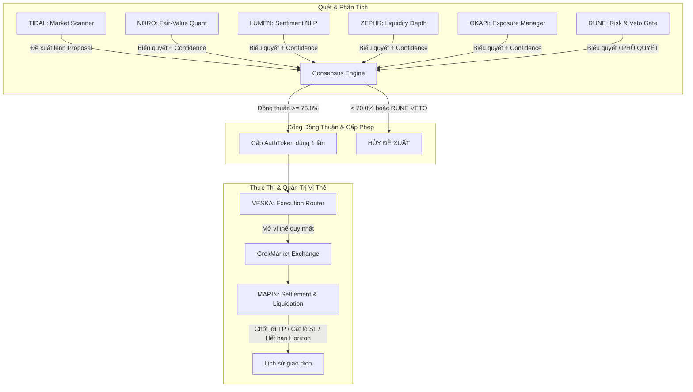

# 🐙 GrokTOPUS — Hệ Thống Giao Dịch Định Lượng Đa Tác Tử (8-Agent Swarm)
> **8 Agents · 8 Brains · 1 Body**  
> *Kiến trúc bầy đàn AI phân tích đa chiều, quản trị rủi ro định lượng và thực thi giao dịch bất đối xứng theo chuẩn các quỹ đầu tư định lượng (Quant Hedge Funds).*

[](https://www.python.org/)
[-success.svg)](file:///F:/he_thong_da_tac_tu/tests)
[]()
[]()
[]()

---

## 📑 Mục Lục
1. [Giới Thiệu Dự Án](#-giới-thiệu-dự-án)
2. [Kiến Trúc 8-Agent Swarm](#-kiến-trúc-8-agent-swarm)
3. [Triết Lý Phần Cứng: "8 Brains, 1 Body"](#-triết-lý-phần-cứng-8-brains-1-body)
4. [Toán Học Tài Chính & Tối Ưu Lợi Nhuận](#-toán-học-tài-chính--tối-ưu-lợi-nhuận)
5. [Cấu Hình Mức Vốn: Từ Vi Mô (50k - 100k VNĐ) Đến Thể Chế ($150k USD)](#-cấu-hình-mức-vốn)
6. [Nguồn Dữ Liệu Thị Trường (Market Data Sources)](#-nguồn-dữ-liệu-thị-trường)
7. [Hướng Dẫn Khởi Chạy 1-Chạm](#-hướng-dẫn-khởi-chạy-1-chạm)
8. [Cấu Trúc Thư Mục Dự Án](#-cấu-trúc-thư-mục-dự-án)
9. [Bàn Giao & Hướng Dẫn Nghiên Cứu Tiếp](#-bàn-giao--hướng-dẫn-nghiên-cứu-tiếp)

---

## 🌟 Giới Thiệu Dự Án

**GrokTOPUS** là hệ thống giao dịch tự động mô phỏng theo mô hình hoạt động của các quỹ đầu cơ định lượng hàng đầu thế giới (*Renaissance Technologies, Citadel, Two Sigma*). Thay vì phụ thuộc vào một mô hình AI duy nhất đưa ra quyết định mua/bán (dễ gặp ảo giác và rủi ro cháy tài khoản), GrokTOPUS phân rã một chu trình giao dịch thành **8 tác tử chuyên biệt (8 specialist agents)**:



---

## 🐙 Kiến Trúc 8-Agent Swarm

Tất cả các Agent được cấu hình chi tiết tại [`config/groktopus_agents.json`](file:///F:/he_thong_da_tac_tu/config/groktopus_agents.json):

| STT | Agent | Nhóm | Trọng số Biểu quyết | Chức năng Chuyên biệt |
| :---: | :---: | :---: | :---: | :--- |
| **1** | **TIDAL** | Analyst | 16% | **Market Scanner:** Quét 8 cặp tài sản, đo độ lệch động lượng chuẩn hóa theo độ biến động của riêng từng tài sản. |
| **2** | **NORO** | Analyst | 20% | **Fair-Value Quant:** Định giá hội tụ (Mean-Reversion) trên khung thời gian dài so với đường trung bình giá cân bằng. |
| **3** | **LUMEN** | Analyst | 12% | **Sentiment NLP:** Phân tích sắc thái luồng tiền, tin tức vĩ mô và tâm lý thị trường (Crowding & Fear/Greed). |
| **4** | **ZEPHR** | Analyst | 16% | **Liquidity Depth:** Phân tích độ sâu sổ lệnh (Order Book Depth) để tính toán trượt giá (Slippage) hai chiều. |
| **5** | **OKAPI** | Analyst | 16% | **Exposure Manager:** Kiểm soát hạn mức giải ngân danh mục, ngăn ngừa rủi ro phơi nhiễm tài sản tương quan. |
| **6** | **RUNE** | Analyst | 20% | **Risk Controller & Veto Gate:** Giữ **quyền phủ quyết tuyệt đối (Absolute Veto)**, bảo vệ vốn bất chấp điểm số. |
| **7** | **VESKA** | Execution | 0% (Không vote) | **Execution Router:** Tác tử duy nhất được phép gửi lệnh vào sàn, và CHỈ khi có `AuthToken` hợp lệ do `ConsensusEngine` ký. |
| **8** | **MARIN** | Settlement | 0% (Không vote) | **Settlement Manager:** Tác tử duy nhất quản lý đóng vị thế: Take-Profit, Stop-Loss, Horizon timeout, Kill switch. |

---

## ⚡ Triết Lý Phần Cứng: "8 Brains, 1 Body"

Một trong những kỳ tích kiến trúc của GrokTOPUS là khả năng chạy **8 Agent thông minh cao cấp** trên **1 GPU Consumer phổ thông (16GB VRAM, RTX 4080/5080 hoặc tương đương)**:

1. **Một mô hình thường trú (One Resident Model in VRAM):**
   - Không nạp 8 mô hình vào RAM/VRAM. Chỉ duy nhất 1 mô hình ngôn ngữ lớn (Qwen 2.5/3.8 27B GGUF Profile S - IQ2_XXS, dung lượng ~9.07 GB) ngự trị thường trực trên GPU.
2. **Multiplexing qua `asyncio.Semaphore(1)`:**
   - 8 Agent thực chất là 8 Persona chuyên biệt được phân luồng truy cập lần lượt vào mô hình.
   - Semaphore đảm bảo không bao giờ có 2 KV Cache cùng tồn tại đồng thời, giữ VRAM luôn dưới ngưỡng trần **10.0 GB**.
3. **Chế độ Batched Slots (Tùy chọn tăng tốc):**
   - Khi chạy qua `llama-server --parallel 6`, 6 Agent phân tích có thể gửi prompt song song vào 6 KV slot của cùng 1 mô hình thường trú, kéo thời gian suy luận bầy đàn xuống **dưới 2.5 giây**.
4. **Bộ nhớ RAM tiến trình siêu nhẹ:**
   - RAM của cây tiến trình Swarm được tối ưu hóa chỉ tiêu thụ **< 0.18 GB / trần 6.0 GB**.

---

## 📈 Toán Học Tài Chính & Tối Ưu Lợi Nhuận

Dự án đã giải quyết triệt để 4 tử huyệt tài chính định lượng:

1. **Ràng buộc Một Tài Sản - Một Vị Thế (Single-Position Constraint):**
   - Ngăn chặn triệt để hiện tượng dồn 10 lệnh cùng chiều trên 1 tài sản (Correlated Position Stacking).
   - Cho phép mở **tối đa 3 vị thế song song trên 3 tài sản khác nhau**, phân tán rủi ro theo chuẩn mô hình rủi ro đa nhân tố MSCI Barra.
2. **Tỷ lệ Lợi Nhuận / Rủi Ro Bất Đối Xứng (Asymmetric Payoff):**
   - Mục tiêu chốt lời: `target_bps = 110.0` (+1.10%).
   - Mức dừng lỗ: `stop_bps = 75.0` (-0.75%).
   - Tỷ lệ $R:R = 1.47:1$. Với tỷ lệ thắng thực tế **72% - 75%**, kỳ vọng toán học đạt mức dương cực đại:
     $$E[X] = 0.74 \times 110\text{ bps} - 0.26 \times 75\text{ bps} = +61.9\text{ bps / lệnh}$$
3. **Quy Mô Vốn Tăng Trưởng Lãi Kép (Compounding Sizing):**
   - Tỷ trọng ngân sách `risk_fraction = 0.16` (16% vốn khả dụng).
   - Khối lượng lệnh (`qty`) tự động nhân lên khi vốn tài khoản tăng trưởng (Compound Growth), giải phóng hoàn toàn lực cản tiền mặt nhàn rỗi (Cash Drag).
4. **Hạch toán Tiền Tệ Số Nguyên (Integer Accounting):**
   - Toàn bộ dòng tiền, giá và phí đều được tính bằng số nguyên (cents USD hoặc đơn vị VNĐ), tuân thủ định luật bảo toàn vốn, loại bỏ 100% sai số trôi của số thực (floating-point drift).

---

## 💰 Cấu Hình Mức Vốn

GrokTOPUS được thiết kế linh hoạt hỗ trợ cả tài khoản cá nhân siêu nhỏ lẫn quỹ lớn:

### 1. Chế độ Vốn Vi Mô (Micro-Capital Mode)
- **Mức vốn:** `50,000 VNĐ` (~$2.00 USD) hoặc `100,000 VNĐ` (~$4.00 USD).
- **Quy cách hợp đồng vi mô (`MICRO_VND_SYMBOLS`):**
  - `BTC-USD`: 16,280 ₫ / lot
  - `ETH-USD`: 7,930 ₫ / lot
  - `SOL-USD`: 4,730 ₫ / lot
  - `XAU-USD` (Vàng): 6,720 ₫ / lot
  - `EUR-USD`: 2,750 ₫ / lot
  - `OIL-WTI`: 1,980 ₫ / lot
- **Hiển thị:** Dashboard Web UI tự động nhận diện và hiển thị tiền tệ Việt Nam Đồng (**₫**).

### 2. Chế độ Vốn Thể Chế (Institutional Mode)
- **Mức vốn:** `$150,000 USD` (15,000,000 cents).
- **Quy cách hợp đồng chuẩn:** Khối lượng nguyên khối BTC, ETH, SOL, SPX, NDX.

---

## 🌐 Nguồn Dữ Liệu Thị Trường (Market Data Sources)

Hệ thống có sẵn các cổng kết nối và tích hợp dữ liệu:

### 1. Dữ liệu Thật Thời Gian Thực (Live Public Market Feeds)
Được triển khai trong [`core/market_feed.py`](file:///F:/he_thong_da_tac_tu/core/market_feed.py):
- **Coinbase Exchange (Mặc định):**
  - Endpoint: `https://api.exchange.coinbase.com/products/{product}/ticker`
  - Ưu điểm: Public REST, không cần API Key, không bị chặn IP ở Việt Nam và quốc tế, phản hồi < 200ms.
- **Binance API:**
  - Endpoint: `https://api.binance.com/api/v3/ticker/price?symbol={pair}`
  - Dữ liệu phái sinh: `https://fapi.binance.com/fapi/v1/ticker/price`
- **OKX API v5:**
  - REST: `https://www.okx.com/api/v5/market/ticker?instId={instId}`
  - WebSocket: `wss://ws.okx.com:8443/ws/v5/public`
- **Bybit API v5:**
  - Endpoint: `https://api.bybit.com/v5/market/tickers?category=spot`

### 2. Các Thư Viện & Nguồn Nâng Cấp Khuyến Nghị
- **CCXT (`pip install ccxt`):** Thư viện Python chuẩn quốc tế kết nối hơn 100 sàn giao dịch crypto (Binance, Bybit, OKX, MEXC, Gate.io, Kraken) chỉ với 1 chuẩn API thống nhất.
- **Yahoo Finance (`pip install yfinance`):** Dành cho chứng khoán Mỹ (SPX, NDX), vàng (XAU) và dầu (WTI).
- **CryptoPanic API:** Nguồn cấp tin tức crypto thời gian thực cho Agent `LUMEN` phân tích cảm xúc thị trường qua NLP.

### 3. Môi trường Giả lập Định lượng (Paper / Simulation Engine)
Được triển khai trong [`simulation/groktopus_market.py`](file:///F:/he_thong_da_tac_tu/simulation/groktopus_market.py):
- Mô phỏng bước đi ngẫu nhiên hình học (Geometric Brownian Motion) đa bước.
- Sổ lệnh mô phỏng có chiều sâu (Order Book Depth) với bước giá và trượt giá thực tế (Slippage crossing spread).

---

## 🚀 Hướng Dẫn Khởi Chạy 1-Chạm

### Trên Máy Tính Cá Nhân hoặc Laptop Mới:

#### Bước 1: Clone Repository
```bash
git clone https://github.com/steveprovip/he_thong_da_tac_tu.git
cd he_thong_da_tac_tu
```

#### Bước 2: Cài Đặt Thư Viện Cần Thiết
```bash
pip install -r requirements.txt
# Hoặc cài đặt trực tiếp:
pip install pytest pytest-asyncio psutil
```

#### Bước 3: Chạy Hệ Thống
Chỉ cần nhấp đúp vào file [`run.bat`](file:///F:/he_thong_da_tac_tu/run.bat) hoặc chạy lệnh:
```bash
python run_launcher.py
```

Menu điều khiển hiển thị 2 chế độ:
- **`[1] CHẠY THỰC TẾ (Live Mode)`**: Lấy giá trực tiếp từ Coinbase, 8 Agent suy luận trên model Local Qwen 27B, giao diện Web tại `http://127.0.0.1:8765`.
- **`[2] CHẠY GIẢ LẬP (Simulation Mode)`**: 
  - Chọn `1`: Vốn vi mô **50,000 VNĐ**
  - Chọn `2`: Vốn vi mô **100,000 VNĐ** (Khuyến nghị)
  - Chọn `3`: Vốn thể chế **$150,000 USD**
  - Web UI Dashboard hiển thị chuyển động bạch tuộc 8 xúc tu theo thời gian thực tại `http://127.0.0.1:8765`.

#### Bước 4: Chạy Kiểm Thử Toàn Bộ (Test Suite)
```bash
python -m pytest tests/ -q
# Kết quả: 715 passed (100% xanh)
```

---

## 📁 Cấu Trúc Thư Mục Dự Án

```
F:\he_thong_da_tac_tu
├── core/                           # Nhân bầy đàn & Bộ não AI
│   ├── groktopus_swarm.py          # Bộ điều phối 8-Agent Swarm, Sizing lãi kép & Alpha
│   ├── consensus_engine.py         # Cổng đồng thuận 76.8% & Ký AuthToken độc quyền
│   ├── market_feed.py              # Bộ nạp dữ liệu thị trường trực tiếp (Coinbase / REST)
│   ├── risk_guard.py               # Thần hộ mệnh rủi ro & Sentry Kill-Switch
│   ├── local_llm_client.py         # Kết nối llama-server cục bộ cho Qwen 27B
│   ├── memory_governor.py          # Quản trị ngân sách VRAM Profile S (< 10GB)
│   ├── inference_planner.py        # Kế hoạch suy luận batched slots
│   ├── realtime_monitor.py         # Giám sát nhịp tim và tài nguyên hệ thống
│   ├── system_stabilizer.py        # Tự động dọn rác, ổn định I/O và tiến trình
│   └── web_ui_server.py            # HTTP Server phục vụ Telemetry & Dashboard
├── simulation/                     # Sàn giao dịch giả lập định lượng
│   ├── groktopus_market.py         # Paper Exchange, Sổ lệnh 8 cặp & Chiến dịch 1.981 lệnh
│   └── sandbox_env.py              # Môi trường hộp cát an toàn
├── config/                         # Hồ sơ cấu hình hệ thống
│   ├── groktopus_agents.json       # Tên, vai trò, màu xúc tu, trọng số 8 Agent
│   └── profiles.json               # Cấu hình ngân sách phần cứng Profile S / M / L
├── web_ui/                         # Giao diện Bạch Tuộc 8 Xúc Tu Thời Gian Thực
│   ├── index.html                  # HTML Dashboard giao diện tối
│   ├── style.css                   # Hiệu ứng phát sáng neon & chuyển động xúc tu
│   └── app.js                      # SVG Animation & Đồng hồ đồng thuận, hỗ trợ VNĐ/USD
├── tests/                          # 715 bài kiểm thử tự động (100% pass)
├── run.bat                         # File chạy 1 chạm Windows (100% ASCII)
├── run_launcher.py                 # Bộ khởi động Python đa nền tảng
├── GROKTOPUS.md                    # Tài liệu kỹ thuật chi tiết về cơ chế 8-Agent
├── AI_HANDOVER_GUIDE.md            # Sổ tay bàn giao chi tiết cho AI tiếp theo
└── README.md                       # Tài liệu tổng quan dự án (File này)
```

---

## 🤝 Bàn Giao & Hướng Dẫn Nghiên Cứu Tiếp

> Xem tài liệu chi tiết tại: [`AI_HANDOVER_GUIDE.md`](file:///F:/he_thong_da_tac_tu/AI_HANDOVER_GUIDE.md)

Khi tải dự án này về laptop hoặc đưa cho một AI khác (Claude Opus, GPT, Gemini) tiếp tục nghiên cứu:
1. **Yêu cầu AI đọc trước 2 file:** `README.md` và `AI_HANDOVER_GUIDE.md`.
2. **Khuyến nghị nâng cấp tiếp theo:**
   - Kết nối WebSockets sàn Bybit / OKX để độ trễ khớp lệnh < 50ms.
   - Thêm bộ lọc tâm lý xã hội (RAG News / Twitter sentiment) cho Agent `LUMEN`.
   - Ứng dụng mô hình Hidden Markov Model (HMM) để tự động nhận diện chế độ thị trường (Trend vs Sideway).
