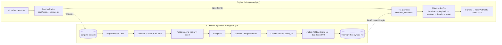

# 02 — Thiết kế module H2-Regime: Harness² trong vòng thích ứng của 8 agent

ARCH-2026-10-24 · trạng thái **THIẾT KẾ** (chưa có code) · phụ thuộc: doc 01 (bất biến I1–I8), `h2_surface_v0.yaml`, doc 03 (sandbox).

## 0. Mục tiêu và không-mục tiêu

**Mục tiêu**
- Khi một symbol chuyển sang ô regime mới, hệ thống tự đề xuất, thử và chọn một **harness** (overlay tham số thực thi + tri thức regime) cho ô đó, theo phương pháp Harness²:
  - đệ quy cấp tác vụ: Propose → Probe → Compose;
  - đệ quy cấp harnessing: thư viện kinh nghiệm theo ô regime.
- Harness chỉ vào **DEMO** sau khi qua holdout tương lai, sandbox 1000 kịch bản và người duyệt.
- I1–I8 (doc 01 §10) giữ nguyên **byte-for-byte**.

**Không-mục tiêu**
- Không hứa tạo edge. Theo báo cáo 10-09, tự học trên cùng tín hiệu chỉ giảm số lệnh thua.
- Không tự động thay đổi live. Không gọi LLM hay replay trong đường nóng.
- Không đổi trọng số, ngưỡng đồng thuận, TokenAuthority. Không tăng size.

## 1. Ánh xạ khái niệm

| Harness² (paper + `third_party/harness2`) | H2-Regime (Groktopus) |
|---|---|
| task (việc chưa thấy lúc thiết kế harness) | `RegimeEpisode`: một giai đoạn regime đã xác nhận trên một symbol |
| domain (nhóm nghề) | ô regime = vol × trend × tox = 18 ô, tách theo symbol |
| harness, 8 thành phần | overlay trên bề mặt `h2_surface_v0.yaml` (bảng §4) |
| executor rollout | `tools/engine_replay.py` (code production) trên băng probe + seed `SandboxVenue` |
| k rollout gốc đọc như một phân phối | k lần replay harness hiện tại với các seed nhiễu queue/latency |
| INV: cách agent làm việc | VESKA/MARIN: TTL, peg, backoff, BE, eject, hurdle |
| DOM: kiến thức người làm nghề | ngưỡng NORO/LUMEN/TIDAL, gate KER/concordance/absorption |
| compose (AGG song song / c_t tuần tự) | hợp nhất các sửa được tương phản hành vi ủng hộ |
| trajectory | decision trace: mẫu funnel 1 Hz (blockers, veto attribution), entry, fill, exit, markout |
| deliverable | tóm tắt ledger của rollout (n, net, fee, markout, exit reasons), không có trường holdout |
| chọn mù, ID ẩn danh | scorecard định trước, ID xáo theo seed, không có số holdout/sandbox |
| judge chỉ chạy sau khi chọn; lỗi = None | holdout **tương lai** (băng ghi sau thời điểm commit) + sandbox |
| library + EXPERIENCE (cue/lesson/evidence/confidence) | thư viện playbook theo (symbol, ô) + edit rows + một bài học hoặc NO_ENTRY |
| ledger R = 4k, P = 3k | giữ nguyên, kèm một dòng `trial_log.jsonl` cho mỗi ứng viên (phạt DSR) |

## 2. Kiến trúc hai tốc độ



Quy tắc cứng:
1. Đường nóng chỉ đọc file đã được validate. Không replay, không LLM, không I/O mạng mới.
2. Chỉ đổi harness khi symbol đang **flat** (giống `Autonomy.refresh`, `core/autonomy.py:82`).
3. Live: không có playbook (§7).
4. Worker là tiến trình riêng, priority thấp, không giữ khóa Binance (không đọc `.env.local`).

## 3. RegimeEpisode: biến chuyển regime thành sự kiện hạng nhất

### 3.1 Khóa regime (dùng feature sẵn có, mỗi 60 s, mỗi symbol tradable)

- **vol** = tercile của `atr15_pct` theo symbol, ngưỡng tính trên 30 ngày gần nhất và chốt mỗi ngày → LO / MID / HI.
- **trend** = KER 120 s: < 0.30 CHOP, 0.30–0.40 MID, ≥ 0.40 TREND. Cùng mốc với `param_bandit.regime_of` và `cs_chop_ker`/`cs_trend_ker`.
- **tox** = tỷ lệ mẫu trong cửa sổ có `vpin > vpin_max` (0.80). ≥ 20 % là TOXIC, còn lại CLEAN.
- Thiếu bất kỳ feature nào → `UNKNOWN`, và `UNKNOWN` **không bao giờ** kích hoạt chuyển episode (cùng tinh thần "unknown KER never confirms", `core/capital_router.py:29-31`).

### 3.2 Hysteresis chống giật

- Cửa sổ W = 45 phút (45 mẫu). Ô thống trị phải chiếm ≥ 60 %.
- Episode mới chỉ bắt đầu khi ô thống trị khác ô hiện tại **và** episode hiện tại đã sống ≥ 30 phút.
- Kịch bản X10 (regime whipsaw) trong sandbox kiểm đúng cơ chế này.

### 3.3 Bản ghi

- `episode_id = f"{symbol}-{cell}-{t_confirm:%Y%m%dT%H%M}"`, ví dụ `SOLUSDT-HI.TREND.CLEAN-20261024T0815`.
- Ghi vào `data/harness2/episodes.jsonl`. Thêm trường `episode_id` và `regime_cell` (additive) vào dòng ledger và mẫu funnel, như cách `LEDGER_SCHEMA = 2` từng thêm trường.
- Router NORMAL/CHOP/BURST giữ nguyên vai trò phân bổ scalp. RegimeKey chỉ phục vụ playbook và H2.

## 4. Bề mặt chỉnh sửa (harness surface)

Nguồn duy nhất: [`h2_surface_v0.yaml`](h2_surface_v0.yaml). Đã kiểm với code: 84 lever (GUARD 23, INV 27, DOM 34), 29 field đóng băng, baseline khớp `PROFILES['demo']`/`['live']` và `config_for()`.

| Thành phần Harness² | Vai trò trong Groktopus | Ví dụ lever | Agent |
|---|---|---|---|
| system prompt | `PROFILES['demo']` baseline: chỉ được overlay, không bao giờ sửa | — | tất cả |
| guardrails | GUARD, chỉ thắt chặt (cap/floor) | `portfolio_risk_usdt`, `jev_min` ≥ 8.0, `peg_min_score` ≥ 0.768 | RUNE, OKAPI, ZEPHR |
| memory | thư viện playbook theo ô (§6) | — | — |
| tool guidance | INV: thủ tục thực thi maker | `gtx_ttl_s`, `peg_interval_s`, `gtx_backoff_ticks` | VESKA |
| subagents | lane: chỉ `'off'`/`'shadow'` (đóng băng ở v0) | `burst_lane`, `stat_arb_lane` | — |
| skills | INV: thủ tục thoát kích hoạt theo điều kiện | `be_trigger_pct`, `eject_s`, `hurdle_pct` | MARIN |
| scripts | DOM: ngưỡng feature của agent alpha | `obi_min`, `vwap_dev_pct`, `liq_usd` | NORO, LUMEN, TIDAL |
| plugins | DOM: gate giữa phiếu bầu và VESKA | `ker_lock`/`ker_unlock` (theo symbol), `conc_ofi`, `absorb_gate` | ZEPHR, LUMEN, NORO |

| kind | sandbox/probe | demo | live |
|---|---|---|---|
| `range` | có | sau cổng G1–G3 + duyệt | không |
| `cap` / `floor` | chỉ theo hướng an toàn | có | đủ điều kiện về hướng (risk-down), nhưng H2 không ghi live |
| `gate` | True luôn được; False chỉ khi probe | False cần quyết định chủ sở hữu | không bao giờ False |
| `enum` | trong `allowed` | trong `allowed` | không |
| `owned` (bandit) | chỉ đề xuất bộ arm | chỉ đề xuất bộ arm | không |
| không có trong danh sách | **đóng băng** | đóng băng | đóng băng |

**Ràng buộc**
- ≤ 6 field mỗi ứng viên (≤ 4 INV, ≤ 4 DOM). Nhiều hơn thì edit rows thành `confounded` ngay từ thiết kế.
- `ker_unlock ≥ ker_lock`; `mr_ker_max ≤ ker_lock`.
- Ngưỡng USD tính theo thang BTC (code nhân `usd_scale`).
- Giá trị enum phải là chuỗi có nháy: PyYAML đọc `off` không nháy thành `False`. Lỗi này đã bắt được khi kiểm spec phiên này.

**Thứ tự validate** (thông báo lỗi trả lại nguyên văn làm phản hồi cho lần thử lại, giống `BenchmarkAdapter.validate_tree`):
1. parse chặt;
2. field đóng băng;
3. kind và biên;
4. ràng buộc chéo;
5. giới hạn số field;
6. kiểm lại hằng số I1–I8;
7. dựng Profile/SignalConfig hiệu lực;
8. tính `policy_id` (`core/engine.py:66`).

## 5. Đệ quy cấp tác vụ (mỗi episode)

### 5.1 Đầu vào

- Cửa sổ probe = [t_confirm, t_confirm + 120 phút] của băng `rec`, cộng 60 phút warm-up trước đó.
- S = 3 seed nhiễu `SandboxVenue` (doc 03 §5): queue position, ack latency 50–400 ms, xác suất khớp khi giá chỉ chạm. Trước khi có SandboxVenue: 3 cửa sổ con lệch thời gian.
- Harness hiện tại H₀ = baseline demo + playbook PASS của ô (nếu có).

### 5.2 Các bước

1. **Base set:** k rollout của H₀ (`base1..basek`), mỗi rollout chạy trên S seed. Một lỗi lặp lại trong cả base set là thật; lỗi chỉ ở 1/k là nhiễu (nguyên tắc AGG của harness2, `prompts.py:916-931`).
2. **Propose:** hai cài đặt cùng giao diện `propose(dim, evidence_dir, current, library) -> HarnessDiff + notes`.
   - `DeterministicProposer` (mặc định, tái lập được):
     - Bảng bẫy → lever, lấy từ trap của dreaming và funnel. Ví dụ:
       - CHURN → INV: tăng `hurdle_pct`/`eject_s`; DOM: tăng `obi_min`/`cvd_min`.
       - ADVERSE → INV: giảm `gtx_ttl_s`/`peg_max_drift_pct`, `aggressive_quote=False`; DOM: tăng `conc_ofi`.
       - FEE_DRAG → GUARD: tăng `min_edge_bps`/`edge_ratio_min`.
       - STREAK → GUARD: tăng `cooldown_s`.
       - UNFILLED cao → INV: tăng `gtx_ttl_s` trong biên.
       - KER-blocker chiếm ưu thế trong ô TREND → DOM: hạ `ker_lock`/`ker_unlock` trong biên.
     - Prior từ thư viện: bắt đầu từ diff của entry PASS cùng ô, rồi kiểm lại.
     - Nhiễu tọa độ: dịch 1–3 lever ±1 bước ((hi − lo)/8), seed = sha256(episode_id | dim | index).
   - `ClaudeProposer` (tùy chọn, **tắt mặc định**):
     - Đọc cây evidence, trả về diff YAML + `<notes>` trích ID dòng trace làm bằng chứng.
     - Chạy trong container: không có `.env.local`, mạng chỉ ra API LLM, evidence mount read-only.
     - **Không bao giờ** `--dangerously-skip-permissions` trên host.
     - Mô hình gợi ý: `claude-opus-5-5`. Ghi chi phí từng phiên vào ledger.
3. **Validate:** sai thì thử lại 1 lần kèm thông báo lỗi. Vẫn sai thì fallback = H₀, gắn nhãn `fell_back` (`recursion.py:180-251`).
4. **Probe:** mỗi ứng viên được replay một lần trên S seed.
5. **Compose:**
   - Song song (`agg`): k bản tổng hợp từ cùng pool (2k ứng viên + base set). Composer tất định giữ một sửa khi ứng viên mang nó cải thiện ≥ 1 chiều scorecard ở ≥ 2/3 seed mà không làm chiều khác tệ quá dung sai. Lấy hợp các sửa được giữ; trùng field thì lấy từ ứng viên có scorecard tốt hơn; không còn gì thì KEEP_BASE. Mỗi bản tổng hợp dùng seed tie-break khác nhau. Độ đa dạng đo bằng line-Jaccard (`tree.diversity`).
   - Tuần tự (`seq`): k vòng. Vòng t đề xuất từ c_{t−1} rồi compose c_t từ toàn bộ lịch sử, được phép khôi phục checkpoint cũ (`prompts.py:964-1008`).
6. **Ledger:** R = 4k (k base + 2k ứng viên + k bản cuối), P = 3k (k INV + k DOM + k compose). Assert như `Ledger.assert_identity`; nhãn trùng là lỗi.
7. **Chọn mù** trong các bản cuối (`agg1..k` hoặc `c1..k`):
   - ID ẩn danh xáo theo seed (`selection.py:71-76`). Loại ứng viên có vi phạm cứng hoặc exception. k = 1 thì chọn tầm thường, không cần selector.
   - Scorecard định trước, xét theo thứ tự với dung sai, tính trên cửa sổ probe × S seed:

   | # | Chiều | Quy tắc |
   |---|---|---|
   | 1 | Cứng | 0 vi phạm I1–I8, 0 exception |
   | 2 | Đuôi | net của seed tệ nhất ≥ net seed tệ nhất của base − 0.5·SD_base |
   | 3 | Chọn ngược | markout 5 s trung bình của fill ≥ base − 0.5 bps |
   | 4 | Phí | Σfee / \|Σgross\| ≤ base + 0.10 |
   | 5 | Net | net trung bình theo seed. Hòa trong 1 SE thì chọn bản đổi ít field hơn, rồi ưu tiên INV hơn DOM |

   - Tripwire: evidence và selector không được chứa `holdout`, `sandbox_verdict`, `dsr`, `pbo`, `judge` (bản tương tự `assert_no_grader_verdicts`, `context.py:454-490`).
8. **Commit:** ghi overlay, hash, `policy_id`, `code_version` vào `selection.json` **trước** khi cửa sổ holdout bắt đầu.
9. **Judge** (chỉ sau commit; judge lỗi = `None`, không bao giờ là 0):
   - **J1, holdout tương lai:** [t_commit, t_commit + 240 phút], là băng chưa tồn tại lúc chọn, nên không thể nhìn trước theo cấu trúc. Replay base vs chọn × S seed để có Δ ghép cặp. Một episode chỉ là bằng chứng yếu; gộp theo ô (E-H2-1, doc 04).
   - **J2, sandbox:** chạy suite trên policy hiệu lực (doc 03), cho ra verdict theo khóa (policy_id, code_version, suite_sha).

## 6. Đệ quy cấp harnessing: thư viện playbook theo ô regime

```
data/harness2/
  episodes.jsonl
  queue/<episode_id>.json
  runs/<ns>/<episode_id>/{context/, harnesses/<label>/overlay.yaml, selection.json, summary.json, ledger.json}
  library/<mode>/<symbol>/<cell>/INDEX.md
  library/<mode>/<symbol>/<cell>/entries/<episode_id>/{overlay.yaml, EXPERIENCE.md, judge.json}
ns = f"h2-{mode}{k}-s{seed}-{suite}"      (cùng sơ đồ đặt tên với schedule.ns của harness2)
```

- **EXPERIENCE.md** (`selection.py:454-505`):
  - Edit rows: thành phần, field, ứng viên mang sửa, thay đổi, tương phản quan sát theo seed, verdict `helped` / `hurt` / `no observed effect` / `confounded`.
  - Tối đa **một** bài học (cue = hình dạng tình huống regime; lesson = thao tác trên một lever có tên; evidence; confidence) hoặc `NO_ENTRY`. Bài học chỉ dựa trên dòng `confounded` thì bị từ chối.
- **Nhân quả:** một episode chỉ đọc entry của các episode đã kết thúc trước t_confirm của nó (`Library.retain`, `schedule.py:699-701`).
- **Vòng đời judge:** `PENDING → PASS | FAIL | NONE`. Truy xuất ưu tiên PASS. FAIL được giữ làm bằng chứng âm và không bao giờ được áp.
- **Phân rã:** entry không được xác nhận lại trong 30 ngày hoặc 10 episode cùng ô → `STALE` (vẫn đọc được, không áp).
- **Ghi nhớ:** mỗi entry PASS → `engram save … --project he_thong_da_tac_tu_2`. Mỗi ứng viên đã probe → một dòng `docs/research_upgrade/trial_log.jsonl`, nên DSR của `ab_bench` tự phạt theo độ rộng tìm kiếm.

## 7. Triển khai và thang thăng cấp

| Mức | Điều kiện | Hiệu lực |
|---|---|---|
| L0 SHADOW | mặc định | chỉ replay/sandbox; telemetry ghi "playbook sẽ áp" |
| L1 DEMO | J1 gộp ≥ 5 episode cùng ô (CI95 thấp > 0 nếu tuyên bố "tốt hơn", ≥ −m nếu "an toàn hơn"); J2 PASS cho đúng (policy_id, code_version, suite_sha); **người duyệt** | ghi `config/regime_playbook.json`; engine demo áp khi flat |
| L2 LIVE | không bao giờ tự động: commit có review vào `PROFILES['live']` sau ≥ 14 ngày L1 với `fast_eval.msprt`/`sprt` xác nhận edge, suite LIVE PASS (phí +2 bps, latency ×2, bão reject), chủ sở hữu ủy quyền bằng gõ phím | vốn vẫn ≤ 3.85 U; I6 giữ nguyên |

`config/regime_playbook.json` (schema đề xuất):

```json
{"version": 1,
 "entries": {"SOLUSDT|HI.TREND.CLEAN": {
   "episode": "SOLUSDT-HI.TREND.CLEAN-20261024T0815",
   "overlay": {"profile": {"gtx_ttl_s": 2.5}, "signal": {"conc_ofi": 0.40}, "bandit_arms": {}},
   "policy_id": "<10 hex>", "code": "<commit>", "suite_sha": "<sha256>",
   "verdict": "PASS", "approved": {"by": "owner", "at": 0, "sha256": "<entry hash>"},
   "expires_at": 0}}}
```

- **Loader `core/playbook.py`** (phòng thủ nhiều lớp):
  - validate lại theo surface;
  - kiểm khóa verdict khớp `CODE_VERSION`;
  - chỉ chạy khi `mode == 'demo'` và `autonomy == 'on'`, chỉ áp khi flat;
  - hết hạn hoặc lỗi → quay về baseline.
- **Thứ tự hợp nhất:** baseline → playbook → tunables (chỉ thị giảm rủi ro của dreaming luôn thắng) → arm của bandit (field `owned`) → router observer.
- **Duyệt:** `tools/h2_approve.py` đòi terminal người thật. `sys.stdin.isatty()` là True với NUL trên Windows, nên phải kiểm thêm `GetConsoleMode`, theo learnings 2026-10-11. Người duyệt gõ cụm xác nhận chứa 8 ký tự đầu của hash entry. Agent chạy shell (stdin = NUL) không tự duyệt được.
- **Tự hạ cấp** (không cần duyệt vì là hướng giảm rủi ro): có vi phạm cứng, hoặc mSPRT shadow-vs-active bác bỏ, thì entry bị gỡ và engine quay về baseline.

## 8. Nâng cấp thuật toán đồng thuận (trong bất biến)

| ID | Nội dung | Tác động lên quyết định | Điều kiện |
|---|---|---|---|
| C1 | **Invariant lock:** `core/invariants.py` gom hằng số (0.768, 0.70, WEIGHTS sha, `'gtx'`, `JEV_MIN_FLOOR` 8.0, TTL 5 s, 3.85 / 0.05 U) và hàm kiểm (`check_consensus`, `check_profile`, `check_runtime_args(mode)`). Gọi khi Engine khởi tạo, trong surface validator và hard gate của sandbox. | không | D1 (mainnet từ chối τ thấp), D2 (trend_floor mặc định = threshold) |
| C2 | **N_eff:** từ mẫu funnel theo ô, tính tương quan phiếu alpha ρᵢⱼ và N_eff = (Σw)² / ΣΣ wᵢwⱼρᵢⱼ; đếm lệnh "một nguồn" (chỉ một alpha có strength cùng phía). | chỉ telemetry; chỉ số theo dõi trong sandbox | luật veto-only tương lai cần E-C2 PASS |
| C3 | **Learner theo regime:** trạng thái `SwarmLearner` theo ô, co về thống kê toàn cục (n₀ = 10); đổi khóa khi episode đổi; mute không mang sang ô khác. | vẫn chỉ demote | replay A/B ≥ 2 tuần; D3 (gộp hai learner) |
| C4 | **Tách JEV khỏi sizing:** tier conviction theo `diag['consensus']` thô thay vì score đã nâng. Vấn đề treo từ báo cáo 10-09. | giảm size đường JEV | D4; chạy shadow trước |
| C5 | **Telemetry hiệu chuẩn:** reliability của các bin consensus thô (0.70–0.768, 0.768–0.85, 0.85–0.95, ≥ 0.95, JEV) so với tỷ lệ net > 0 và net bps trung bình, theo ô, hồi quy isotonic. | không | — |

## 9. Giao diện và bố cục mã

```python
# research/h2/spec.py  (offline; không import trong core/ ngoài core/regime_episode.py, core/playbook.py)
@dataclass(frozen=True)
class RegimeEpisode:
    episode_id: str; symbol: str; cell: str; t_confirm: float; t_probe_end: float; features: dict

@dataclass(frozen=True)
class HarnessDiff:
    profile: dict; signal: dict; bandit_arms: dict; notes: str

@dataclass
class RunView:                                   # không bao giờ mang điểm (như harness2 spec.RunView)
    label: str; run_id: str; run_dir: Path; ok: bool; delivered: bool; error: str = ''

class Adapter(Protocol):
    def execute(self, ep: RegimeEpisode, overlay: Path, run_id: str, seeds: Sequence[int]) -> Path: ...
    def trajectory(self, run_dir: Path) -> str: ...      # [DECIDE]/[VETO]/[ORDER]/[FILL]/[EXIT]
    def deliverable(self, run_dir: Path) -> dict: ...    # tóm tắt ledger, không có trường holdout
    def validate(self, diff: HarnessDiff) -> list[str]: ...
    def judge(self, ep: RegimeEpisode, chosen: Path) -> dict | None: ...   # chỉ judge.py gọi, sau commit
```

| File | Vai trò |
|---|---|
| `core/regime_episode.py` | hàm thuần: khóa regime, tracker hysteresis. An toàn cho đường nóng. |
| `core/playbook.py` | loader + validator `config/regime_playbook.json` |
| `core/invariants.py` | C1 |
| `research/h2/{spec, surface, evidence, proposers, recursion, ledger, selection, library, judge}.py` | phương pháp. Phần port từ harness2 giữ header Apache-2.0 và dòng ghi nguồn. |
| `tools/h2_run.py` | chạy một episode: `--k`, `--mode parallel|sequential`, `--dry-run` |
| `tools/h2_worker.py` | đọc hàng đợi, mỗi lúc tối đa 1 job/symbol |
| `tools/h2_approve.py` | người duyệt playbook |

**Vì sao port thay vì import harness2:** Python 3.12 (dự án 3.10), `fcntl`, substrate là agent LLM viết code. Phần cần dùng là phương pháp (ledger, chọn ẩn danh, thư viện nhân quả, tripwire) và nó nhỏ. Kênh LLM tùy chọn có thể chạy harness2 nguyên bản trong container Linux qua một `BenchmarkAdapter` mỏng (track nghiên cứu, doc 04 P7).

## 10. Ngân sách tính toán và độ trễ

- **Đường nóng:** RegimeTracker O(1) mỗi 60 s, tra playbook O(1) khi đổi episode. Mục tiêu < 50 µs khấu hao mỗi tick; chi phí per-tick đã đo trong progress log là 0.5–31 µs.
- **H2 mỗi episode** (k = 1, S = 3, 3 sim-h mỗi lần chạy theo seed):
  - R = 4, tức 36 sim-h. Ở 0.08 sim-h/s (đo trên `agg`) là ~450 CPU-s.
  - Băng `rec` dày hơn 2–4 lần → 15–30 CPU-phút, tức ~4–8 phút wall với 4 worker.
  - k = 2 song song thì gấp đôi.
- **Sandbox:** doc 03 §6.

## 11. Chế độ hỏng và giảm thiểu

| Rủi ro | Giảm thiểu |
|---|---|
| Overfit cửa sổ probe | chọn mù; holdout tương lai; DSR tính mọi lần thử; ≤ 6 field |
| Regime whipsaw | dwell 30 phút, dominance 60 %, chỉ đổi khi flat; X10 |
| Hai bộ điều khiển cùng một núm | field `owned` của bandit; thứ tự hợp nhất cố định |
| Đầu độc thư viện | `confounded`, NO_ENTRY, trạng thái judge, phân rã |
| Prompt injection qua evidence (khi bật LLM) | evidence là dữ liệu, không phải lệnh; đầu ra có cấu trúc; validator; container |
| Trôi bất biến | danh sách đóng băng + C1 + hard gate sandbox |
| Lỗ hổng dữ liệu | phủ băng < 95 % → bỏ episode, judge = None |
| Quá tải tính toán | hàng đợi ưu tiên theo tần suất ô; 1 job/symbol; bỏ episode < 60 phút |
