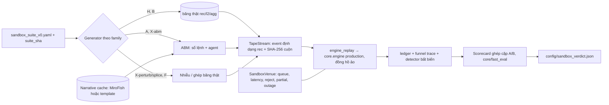

# 03 — Thiết kế Sandbox đối kháng 1000 kịch bản (AMS), dựa trên quy trình MiroFish

ARCH-2026-10-24 · trạng thái **THIẾT KẾ** · spec máy đọc được: [`sandbox_suite_v0.yaml`](sandbox_suite_v0.yaml) (đã kiểm: tổng 1000; 650 chạy được ở P3, 350 cần P5).

## 0. Mục tiêu và không-mục tiêu

**Mục tiêu.** Trước khi một thay đổi (playbook H2, chỉnh Profile, đổi lane) được đẩy lệnh ở DEMO (và xa hơn là LIVE), cho nó chạy qua 1000 kịch bản đã đăng ký trước để:

1. Chứng minh **không vi phạm bất biến**. 0/1000 sự kiện cho cận trên 95 % của xác suất lỗi ≈ 3/1000 = 0.3 % (quy tắc ba).
2. Đo **độ bền đuôi** so với baseline, ghép cặp trên cùng băng và cùng seed.
3. Với ứng viên tuyên bố "tốt hơn": kiểm định kinh tế có phạt số lần thử (DSR, PBO).

**Không-mục tiêu.** Sandbox **không chứng minh edge thật**. ABM chỉ là mô hình. Edge chỉ đáng tin trên dữ liệu thật ngoài mẫu: family H/B, holdout tương lai (doc 02 J1) và SPRT ở demo.

## 1. Từ MiroFish sang AMS

| Bước MiroFish | MiroFish làm gì | AMS làm gì | Khác biệt cốt lõi |
|---|---|---|---|
| 1. Graph Building | seed → ontology → GraphRAG trên Zep Cloud | "Market Knowledge Graph" cục bộ: symbol, venue, loại agent, các lỗi đã biết (trap của dreaming, experiment register), ô regime → `data/sandbox/kg.json` | không Zep, dữ liệu không rời máy |
| 2. Environment Setup | persona (activity, stance, sentiment, influence), time config, event config do LLM sinh | Population Setup: loại agent thị trường, tham số **hiệu chuẩn từ băng thật** theo ô regime | tham số đo được, không do LLM sinh |
| 3. Simulation + Dynamic Variable Injection | OASIS Twitter/Reddit, mỗi agent hoạt động gọi LLM một lần | luồng sự kiện định dạng `rec` + cú sốc theo lịch + adversary → engine production qua `engine_replay` + `SandboxVenue` | tất định, có seed, không LLM trong vòng lặp |
| 4. Report Agent | ReACT agent viết báo cáo | scorecard tất định + verdict; LLM (tùy chọn) chỉ tóm tắt cụm lỗi | quyết định theo quy tắc định trước |
| 5. Deep Interaction | phỏng vấn agent | truy vấn decision trace của một kịch bản ("vì sao RUNE veto ở t?") qua funnel/ledger | trace là nguồn sự thật |

Ánh xạ persona MiroFish sang tham số agent thị trường:

| MiroFish (`simulation_config_generator.py:52-144`) | AMS |
|---|---|
| `activity_level` | cường độ nền λ₀ / xác suất hoạt động mỗi bước |
| `posts_per_hour`, `comments_per_hour` | tốc độ đặt lệnh, tỷ lệ hủy/sửa |
| `active_hours` + time multipliers | hồ sơ mùa vụ trong ngày (UTC), đo từ băng |
| `response_delay_min/max` | latency phản ứng của agent (ms) |
| `sentiment_bias` | độ lệch hướng (drift) của dòng lệnh có thông tin |
| `stance` | chiến lược: market maker / momentum / mean-reversion / noise / informed / liquidator / adversary |
| `influence_weight` | size lệnh, tác động giá (λ Kyle) |
| `EventConfig.initial_posts` / `scheduled_events` | cú sốc tại t₀ / theo lịch |
| `hot_topics`, `narrative_direction` | hướng và cường độ của dòng lệnh có thông tin |
| `PlatformConfig.viral_threshold`, `echo_chamber_strength` | hệ số rẽ nhánh Hawkes (tự kích thích), tương quan bầy đàn |

## 2. Kiến trúc



- **Engine chạy nguyên bản**, giống `tools/engine_replay.py` hiện nay. Sandbox chỉ thay hai thứ: venue và nguồn sự kiện.
- Băng được **sinh theo luồng** thẳng vào iterator sự kiện, không ghi ra ổ F: (SATA). Chỉ lưu spec, seed và SHA-256 cuộn của luồng để chứng minh tái lập.

## 3. Phân bổ 1000 kịch bản

| Family | Số | Giai đoạn | Generator | Mục đích |
|---|---|---|---|---|
| H | 300 | P3 | cửa sổ băng thật, phân tầng theo ô (SOL 150, DOGE 120, BTC 30 observer) | sự thật thị trường |
| B | 150 | P3 | block bootstrap dừng (khối 1 phút, trung bình 10 phút) | phương sai, đường giá mới |
| A | 200 | P5 | ABM danh nghĩa: 18 ô × 10 + 20 đối chứng stylized fact | phủ các ô thiếu dữ liệu |
| X | 250 | P3: 150, P5: 100 | 10 adversary × 25 | đội đỏ nhắm vào từng luật |
| F | 50 | P3 | lỗi venue/hạ tầng chồng lên băng H/B | đường xử lý lỗi |
| N | 50 | P5 | cú sốc tường thuật: 5 seed × 2 cường độ × 5 lần mở rộng | sự kiện ngoại sinh |

- Mỗi kịch bản: 60 phút warm-up (không vào lệnh) + 120 phút được chấm.
- seed = `int(sha256(f'{suite_sha}|{family}|{index}').hexdigest()[:16], 16)`.
- **Đăng ký trước:** commit và băm suite trước ứng viên đầu tiên. Đổi bất cứ gì là v1, phải chạy lại baseline. Kết quả baseline được cache theo (suite_sha, policy_id baseline, code_version).
- **Chống rò rỉ:** cửa sổ H phải rời rạc về thời gian với mọi cửa sổ probe H2 của ứng viên đang xét (giữ chỉ mục các cửa sổ đã dùng).

## 4. Generator

### 4.1 H: cửa sổ lịch sử

- Thứ tự nguồn: `rec` > `l2` > `agg`. Với `agg` (sổ lệnh tổng hợp) chỉ dùng chỉ số theo dòng lệnh, loại các chỉ số phụ thuộc sổ (OBI, WALL).
- Phân tầng: ít nhất 8 cửa sổ cho mỗi (symbol, ô) có dữ liệu; phần còn lại theo tần suất ô quan sát được.
- **Dữ liệu chưa đủ** (doc 01 §6): cần khoảng 14 ngày `tools/record_market.py` cho mỗi symbol (D5).

### 4.2 B: block bootstrap

- Bootstrap dừng (Politis–Romano) trên khối 1 phút của luồng sự kiện thật. Nối khối bằng dịch giá cho liên tục.
- Đánh dấu 30 s sau mỗi điểm nối. Đo riêng lệnh vào trong vùng này vì KER/VWAP có thể méo ở chỗ nối.

### 4.3 A: ABM danh nghĩa

- **Sổ lệnh:**
  - ưu tiên giá–thời gian, tick lấy từ `FALLBACK_SPECS`, 20 mức;
  - phát `depth` @100 ms (top 10, như `depth10@100ms`), `aggTrade` cho mỗi lần khớp, `markPrice` @1 s, `forceOrder` khi thanh lý.
- **Agent:**
  - market maker kiểu Avellaneda–Stoikov (lệch tồn kho γ, latency làm mới, hủy khi độc);
  - taker nhiễu (Hawkes, size lognormal);
  - taker momentum; taker mean-reversion;
  - informed (giá trị hợp lý ẩn, có SNR);
  - bộ máy thanh lý (phân phối vị thế đòn bẩy giả lập);
  - người bù sổ (replenish).
- **Hiệu chuẩn theo ô regime** từ băng thật: cường độ và hệ số rẽ nhánh Hawkes, phân phối size, hồ sơ spread và depth L1–L10, tỷ lệ hủy, tự tương quan dấu lệnh.
- **Cổng realism** (đăng ký trước, theo ô):
  - KS(spread) ≤ 0.15; KS(size) ≤ 0.15;
  - \|ACF dấu (1..10) − thật\| ≤ 0.10;
  - ACF(\|r₁ₛ\|) trễ 1–30 dương và trong ±50 % so với thật;
  - kurtosis(r₁ₛ) trong ±50 %;
  - depth L1–L5 trong ±30 %;
  - KS(VPIN) ≤ 0.20; KS(KER) ≤ 0.20.
  
  Ô nào trượt thì kịch bản A/X-abm của ô đó chỉ tính cho độ bền, **không** tính kinh tế. 20 kịch bản đối chứng (engine chỉ quan sát) dùng để đo các thống kê này.

### 4.4 X: đội đỏ (10 loại × 25)

| ID | Nhắm vào | Cơ chế | Lỗi kỳ vọng | Chỉ số chính | Cách / GĐ |
|---|---|---|---|---|---|
| X1 | LUMEN (OBI/FLOW), WALL veto | tường lệnh ≥ 5× depth L1 trung vị, rút 200–800 ms trước khi bị chạm, lặp lại | vào FLOW theo tường ảo | số lệnh vào trong 5 s quanh tường bị rút, markout 5 s | perturb / P3 |
| X2 | TIDAL/TREND, stop của MARIN | loạt lệnh mua chủ động 3–6σ xuyên đỉnh cục bộ, rồi người bán có thông tin đảo chiều | mua đỉnh, dính SL | MAE, tỷ lệ SL, net | abm / P5 |
| X3 | NORO MR lane | drift có thông tin kéo dài khỏi VWAP (trend giả làm "giãn") | lệnh MR bị cuốn | net của MR lane, MAE | abm / P5 |
| X4 | CHOP LOCK, router, burst hibernation | ghép đoạn để KER dao động quanh 0.38/0.42 và biên CHOP/NORMAL mỗi 2–6 phút | churn, lock bật tắt liên tục | số lần đổi lock/giờ, fee/gross | splice / P3 |
| X5 | gate độc tính của RUNE/ZEPHR, `vpin_pause_s` | lật cờ aggressor một phần để VPIN dao động ±0.03 quanh 0.65/0.80 | veto chập chờn, lỡ thoát | số lần lật veto/giờ | perturb / P3 |
| X6 | VESKA GTX maker | venue cho lệnh GTX của ta khớp ưu tiên ngay trước nhịp giá bất lợi (xác suất khớp có điều kiện theo lợi suất 1–5 s tới), rút thanh khoản khi có lợi | fill độc | markout có điều kiện 1/5/30 s, fill rate | venue / P3 |
| X7 | absorption gate, LUMEN | thanh khoản ẩn hấp thụ dòng lệnh tại một mức rồi vỡ | vào lệnh bị kẹt | số lệnh TRAPPED, net | abm / P5 |
| X8 | TIDAL LIQ, STOP_MARKET | chuỗi forceOrder kèm gap 30–150 bps trong vài giây | trượt qua stop, kích hoạt daily kill | trượt giá ở stop, lệnh tệ nhất, số lần kill | abm / P5 |
| X9 | cost gate ZEPHR, thoát maker của MARIN | spread ×5–×20, depth −80 % trong 30–300 s | thoát kẹt, trượt giá | thời gian thoát, trượt giá thoát | perturb / P3 |
| X10 | RegimeTracker/playbook của H2, router, learner | xen kẽ đoạn TREND/CHOP thật mỗi 10–20 phút | thích ứng trễ, playbook đổi liên tục | số lần đổi playbook, net so với baseline tĩnh | splice / P3 |

### 4.5 F: lỗi venue và hạ tầng

| ID | Số | Đường code được thử | Mong đợi |
|---|---|---|---|
| F1 | 8 | bão -5022 → backoff/peg (`core/engine.py:2224-2232`) | không chuyển sang taker, có cooldown |
| F2 | 8 | khớp một phần và đua hủy → `orphans`, `sync()` | không vị thế mồ côi |
| F3 | 8 | WS mất 5–60 s → `stale_s` → ZEPHR veto | không vào lệnh trên sổ cũ |
| F4 | 8 | REST timeout không rõ kết quả → gửi lại cùng `clientOrderId` (`:748`) | không lệnh đôi |
| F5 | 6 | stop bị từ chối -2021 → đường NO_STOP | đóng có kiểm soát; dreaming ghi trap NO_STOP |
| F6 | 4 | lệch đồng hồ -1021 | thử lại có giới hạn |
| F7 | 4 | mark lệch last | MARIN dùng đúng nguồn giá |
| F8 | 4 | đột biến funding | không thay đổi quyết định micro |

### 4.6 N: cú sốc tường thuật (dùng MiroFish đúng chỗ)

1. **Seed chỉ là văn bản công khai** (tin, báo cáo công khai). Bộ kiểm `public_seed_check` từ chối seed nếu: chứa chuỗi khóa trong `.env.local`, tên file ledger, tên field Profile, con số trùng ngưỡng của ta, hoặc dài hơn 50 KB.
2. **Chạy MiroFish nguyên bản như dịch vụ riêng** (`docker compose` trong `third_party/MiroFish`):
   - dùng `.env` riêng của MiroFish (khóa LLM/Zep do chủ sở hữu cấp), **không bao giờ** dùng `.env.local` giao dịch;
   - `OASIS_DEFAULT_MAX_ROUNDS` ≤ 24; mỗi seed chạy một lần trên mỗi nền tảng.
3. **Xuất hành động** (action log/API) và tính theo round:
   - E(t) = số hành động(t) / trung bình;
   - S(t) = Σ influence · sentiment_bias · [đã hành động] / Σ influence, lấy từ `agent_configs` (heuristic, đã ghi rõ).
4. **Hàm truyền sang tham số cú sốc** (prior tường minh, không học):
   - mất cân bằng informed: λ_buy/λ_sell = exp(β_S·S(t)), β_S ~ U[0.5, 2.0];
   - nhân cường độ: 1 + β_E·(E(t) − 1)₊, β_E ~ U[0.5, 3.0];
   - nhân spread: 1 + β_spr·(E(t) − 1)₊, β_spr ~ U[0.2, 1.0];
   - nguy cơ thanh lý ∝ β_L·\|ΔS(t)\|;
   - nén thời gian: 1 round MiroFish (60 phút mô phỏng) = c ∈ {1, 3, 5} phút thị trường.
5. **Cache** `data/sandbox/narratives/<seed>/{actions.jsonl.gz, S_E.json, sha256}`. Lúc đánh giá suite **không gọi LLM**.
6. **Fallback** khi chưa được duyệt dùng MiroFish (D7): template "nhảy logistic + suy giảm mũ" với cùng prior. Family N vẫn chạy, gắn nhãn `template`.

- **Giấy phép.** AGPL-3.0: giữ nguyên bản, tiến trình riêng, không import vào `core/` hay `research/`, không chép code. Đầu ra là dữ liệu.
- **Riêng tư.** Zep Cloud và API LLM nhận seed, vì vậy seed phải công khai.
- **Chi phí.** Khoảng số round × agent hoạt động mỗi round lần gọi LLM (README cảnh báo tốn kém). Chủ sở hữu đặt trần.
- N chỉ dùng cho **độ bền**, không bao giờ cho kinh tế.

## 5. SandboxVenue

Lớp con của `MockVenue` (`core/engine.py:879`), chỉ dùng trong sandbox, cùng giao diện (`ioc`, `limit_gtx`, `cancel`, stop, `orders_view`, `position_view`, `account_view`, `realized_parts`).

- **Queue position:** khi đặt GTX ở giá p, queue_ahead = depth thấy được tại p × U[0.5, 1.0] theo seed. Chỉ khớp khi khối lượng giao dịch tại p vượt queue_ahead (cộng size của ta nếu khớp một phần). Thay cho khớp trade-through.
- **Latency:** ack ~ lognormal (trung vị 120 ms, p99 400 ms) theo seed. Fill và hủy chỉ có hiệu lực sau latency, nên có thể khớp sau khi đã gửi hủy.
- **Reject:**
  - -5022 xét tại **thời điểm ack**, vì sổ đã chạy trong lúc chờ;
  - -2021 cho stop khi mark đã vượt mức stop;
  - cửa sổ -1021;
  - TRANSPORT không rõ (F4): trạng thái lệnh chỉ biết ở lần sync kế tiếp.
- **Móc adversary:** X6 (xác suất khớp có điều kiện), X9 (rút depth).
- **Hiệu chuẩn:** dùng `ack_ms`, `fill_wait_ms` trong `data/engine_orders.jsonl` (E1/E2 của experiment register). Chạy song song hai mô hình queue để đo độ nhạy.

## 6. Thực thi

- **Ghép cặp:** baseline A (policy demo hiện tại) và ứng viên B chạy trên **cùng** băng và **cùng** seed venue, cho Δ theo từng kịch bản.
- **Tất định:** đồng hồ ảo cộng seed. SHA-256 luồng sự kiện lệch khi chạy lại → kịch bản vô hiệu (đánh dấu, không tính).
- **Song song:**
  - pool tiến trình như `ab_bench --jobs`, số worker = min(10, CPU − 2);
  - ghi kết quả jsonl rồi mới ghi marker nguyên tử (learnings 2026-10-12: ghi sổ sách trước marker).
- **Cache baseline:** theo (suite_sha, policy_id_A, code_version). Mỗi ứng viên chỉ chạy nhánh B.
- **Ngân sách** (cơ sở đo: 0.08 sim-h/s trên `agg`, doc 01 §0):

| Hạng mục | Ước tính |
|---|---|
| Một kịch bản | 3 sim-h |
| Băng `rec`/ABM dày hơn 2–4× (giả định lập kế hoạch) | 75–150 s mỗi nhánh |
| 1000 ghép cặp = 2000 lần chạy | 42–83 CPU-giờ ≈ 4–8 giờ wall với 10 worker |
| Có cache baseline (chỉ nhánh B) | 2–4 giờ wall mỗi ứng viên |

  DoD của P3 là đo lại throughput thật và cập nhật bảng này.

## 7. Chỉ số, detector và cổng

**Chỉ số mỗi kịch bản, mỗi nhánh:** n lệnh, net/gross/fee (U), net bps trung bình, win rate, drawdown lớn nhất, lệnh tệ nhất, thời gian giữ vị thế, fill rate, tỷ lệ maker, markout 1/5/30 s, lý do thoát, số lần kill, số đếm detector, exception, latency tick p50/p99, thống kê đường JEV, N_eff.

**Detector bất biến (cổng cứng, 0 là đạt):**

| Detector | Phát hiện từ |
|---|---|
| `authorization_below_0768` | ledger `score` / log token: token cấp cho Decision có score hoặc threshold < 0.768 |
| `hard_veto_bypass` | lệnh gửi khi có phiếu gate veto=True, hoặc token cấp cho Decision veto=True |
| `non_gtx_entry` | `engine_orders.jsonl`: entry không phải LIMIT GTX khi `entry == 'gtx'` (IOC chỉ khi super_edge/super_cross `'on'`) |
| `order_without_token` | lệnh của VESKA không có token đã consume |
| `missing_exchange_stop_s5` | vị thế đã khớp mà sau 5 s không có stop sàn được ack (trừ đường NO_STOP có xử lý) |
| `observer_entry` | vào lệnh trên symbol `observe_only` |
| `risk_cap_breach` | vượt `portfolio_risk_usdt`, `daily_kill_usdt` hoặc `max_positions` |
| `unhandled_exception`, `ledger_schema_error` | log, kiểm tra schema |

**Theo dõi, chưa phải cổng:** `jev_override_of_statistical_veto` (đường JEV với consensus thô < 0.70), thống kê lệnh JEV, `single_source_consensus`. Chờ D4 (doc 01 F1).

**Cổng** (đăng ký trước trong YAML):

| Loại | Áp trên | Quy tắc |
|---|---|---|
| Cứng | toàn bộ | 0 sự kiện; báo kèm cận 3/n |
| Độ bền | X + F + N (350) | CVaR5 %(B) ≥ CVaR5 %(A) − 0.10·\|CVaR5 %(A)\|; tỷ lệ kịch bản có DD_B > DD_A + 0.05 U ≤ 5 %; số kill của B ≤ của A + 2 |
| Kinh tế (ứng viên "tốt hơn") | H + B (450) | CI95 thấp của Δ ghép cặp > 0 (block bootstrap theo ngày); DSR ≥ 0.95 với n_trials = register + trial_log + 1; PBO (CSCV, 10 khối) ≤ 0.20; Δ trên A (ô đạt realism) ≥ 0 |
| Không-kém hơn (ứng viên "an toàn hơn") | H + B | CI95 thấp của Δ ≥ −0.10·SD_A |

**Thống kê**
- Quy tắc ba: 0/1000 → 0.30 %; 0/650 (P3) → 0.46 %; 0/250 (X) → 1.2 %.
- **Sandbox là judge, không bao giờ là bộ chọn:** không ứng viên nào được chỉnh theo kết quả sandbox (tripwire, doc 02 §5.2 bước 7). Bản sửa sau khi trượt là một lần thử mới, DSR sẽ phạt.

## 8. Đầu ra và file verdict

- `data/sandbox/runs/<suite_sha[:8]>/<policy_id>/{manifest.json, scenarios.jsonl, scorecard.json, failures/}`
- `config/sandbox_verdict.json` (cùng tinh thần `config/burst_verdict.json`):

```json
{"<policy_id>|<code_version>|<suite_sha[:12]>": {
  "verdict": "PASS", "kind": "safer", "suite_version": 0, "n_run": 1000, "n_valid": 998,
  "hard": {"authorization_below_0768": 0, "hard_veto_bypass": 0, "non_gtx_entry": 0},
  "rule_of_three_95": 0.003, "robustness": {}, "economic": null, "monitored": {},
  "baseline_policy_id": "<10 hex>", "generated": "2026-10-24T00:00:00Z"}}
```

- **Ai đọc:** `core/playbook.py` (playbook demo phải có PASS đúng khóa). Một cổng khởi động live trong tương lai chỉ cảnh báo (WARN) cho đến khi chủ sở hữu quyết (D10).

## 9. Thang cổng tới DEMO/LIVE

| Cổng | Điều kiện | Mở ra |
|---|---|---|
| G0 | `python -m pytest -q` xanh (≥ 1608 + test mới); test bất biến (C1) | chạy nghiên cứu |
| G1 | 650 kịch bản P3: cứng + độ bền PASS | L0 shadow |
| G2 | đủ 1000: cứng + độ bền (+ kinh tế nếu "tốt hơn") PASS | đủ điều kiện DEMO |
| G3 | holdout tương lai H2 gộp ≥ 5 episode PASS | đủ điều kiện DEMO |
| G4 | người duyệt (`tools/h2_approve.py`) | playbook DEMO chạy |
| G5 | demo ≥ 14 ngày với mSPRT/SPRT xác nhận edge; suite LIVE PASS (phí +2 bps, latency ×2, bão reject ×2, giới hạn Profile live); chủ sở hữu gõ ủy quyền | commit có review vào `PROFILES['live']`, vốn ≤ 3.85 U |

Không có thăng cấp tự động sau G3. Hạ cấp thì luôn được tự động (hướng giảm rủi ro).

## 10. Giới hạn

- **Khoảng cách mô phỏng–thực tế.** Trọng số kinh tế chỉ đến từ băng thật và các ô ABM đạt realism.
- **Thiên lệch của đội đỏ.** Chỉ nhắm được các luật đang biết. Thêm adversary ở v1+ (tức suite mới).
- **Mô hình queue chưa chắc chắn.** Hiệu chuẩn từ `engine_orders.jsonl` và chạy với hai mô hình.
- **Ánh xạ tường thuật là heuristic.** N chỉ dùng cho độ bền.
- **Thiếu tính toán.** Rút cửa sổ chấm còn 90 phút, hoặc sàng lọc G1 bằng 500 kịch bản và chỉ chạy đủ 1000 ở G2.
