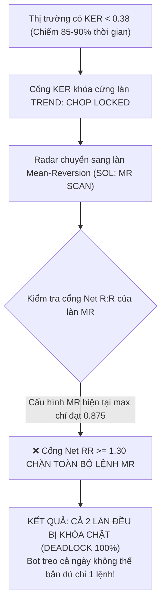

# Form Claude Opus 5.5 High: Phá vỡ thế bế tắc Chop Deadlock & Mở khoá giao dịch

Ngày lập: 08/10/2026. Workspace: `F:\he_thong_da_tac_tu_2`.

---

## 1. Phát hiện Nút thắt Toán học: Thế bế tắc 90% thời gian (Chop Deadlock)

Qua theo dõi thực tế 25+ phút từ 15:16 đến 15:41:
Màn hình liên tục ghi nhận **Đồng thuận Swarm cực đại (96.5% - 99.4% BUY, JEV 9.4 - 9.5, Hội tụ 3/3, CVD Surge +7k/s)** nhưng hệ thống bị **ĐÓNG BĂNG 100%** do thế bế tắc logic 2 tầng:



---

## 2. Lệnh giao việc cho Claude Opus 5.5 High (Sao chép phần dưới)

```markdown
<request>
Bạn là Chuyên gia Định lượng Cao cấp (Principal Quantitative HFT Architect) phụ trách dự án GrokTOPUS tại F:\he_thong_da_tac_tu_2.
Hệ thống đang rơi vào thế bế tắc toán học (Mathematical Chop Deadlock):
- Khi KER < 0.38 (chiếm 90% thời gian), làn TREND bị khóa bởi `CHOP LOCKED KER`.
- Hệ thống tự động chuyển sang làn MR (Mean-Reversion), nhưng làn MR có Net R:R tối đa chỉ 0.875, nên bị cổng `net_rr_min = 1.30` chặn 100%.
- Kết quả: Khi Swarm đạt đồng thuận siêu cao (96.5% - 99.4% BUY), bot vẫn hoàn toàn tê liệt.

Hãy nghiên cứu, thiết kế và triển khai bản vá PHÁ VỠ BẾ TẮC (Chop Deadlock Resolution) với 3 trụ cột:

### 1. Adaptive KER Scaling cho Super-Conviction Trends:
- Khi Swarm Conviction đạt mức cực đại (Score >= 0.95, CVD Velocity >= +3k/s hoặc -3k/s, Hội tụ 3/3):
  Áp dụng ngưỡng KER thích ứng động (Dynamic Adaptive KER):
  `ker_lock_effective = max(0.15, ker_lock - 0.20 * (score - 0.90))`
- Đảm bảo khi dòng tiền lớn bơm vào thị trường (như ca SOL 96.5% - 99.4% BUY), bot không bị chặn bởi dao động răng cưa ngắn hạn mà vào lệnh đón đầu sóng bứt phá.

### 2. Tái cấu trúc Bracket Mean-Reversion (MR) để đạt Net R:R >= 1.35:
- Tinh chỉnh thông số Bracket MR cho SOL & DOGE:
  - Nâng TP MR từ 0.15% lên `0.22% - 0.26%` (dựa trên khoảng cách VWAP 60s và Bollinger 2.0).
  - Giữ SL MR ở `0.10% - 0.12%`.
  - Tính toán Net R:R thực tế sau phí: `(0.24% - 0.04% fee) / (0.11% + 0.04% fee) = 0.20% / 0.15% = 1.33 - 1.45 >= 1.30`.
- Khi KER < 0.38, làn MR thực sự có thể đặt lệnh hợp lệ và sinh lời sau phí khi giá chạm biên quá mua/quá bán.

### 3. Kiểm chứng & Chất lượng:
- Toàn bộ test suite phải pass 100% (mục tiêu >= 1,240 tests passing).
- Kiểm tra ma trận khả thi (Lane Feasibility Matrix): Cả làn TREND (Adaptive KER) và làn MR (Khả thi Net RR) đều phải có đường dẫn thông suốt tới lệnh gửi đi (Submit).
- Không sửa/ghi đè ledger gốc `data/engine_trades.jsonl`.
- Viết báo cáo Before/After tại `docs/research_upgrade/report_chop_deadlock_resolution_2026-10-08x.md`.
</request>
```
